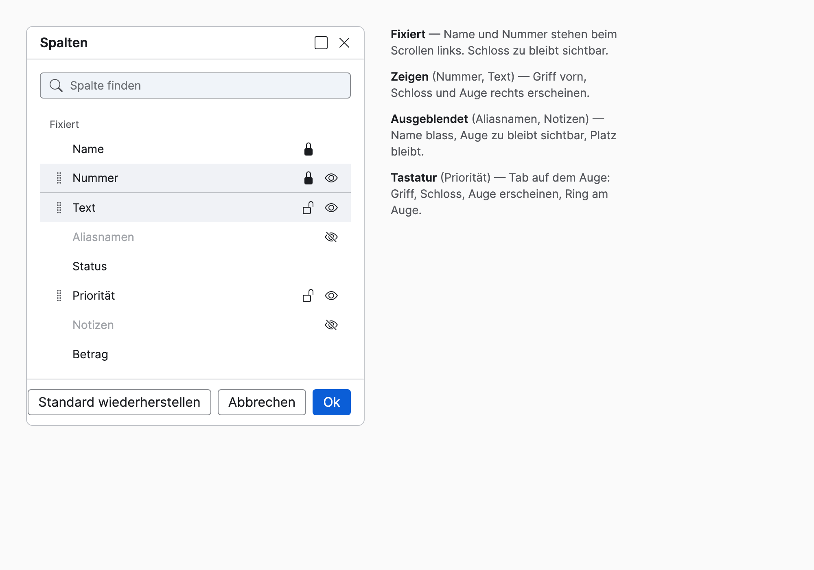
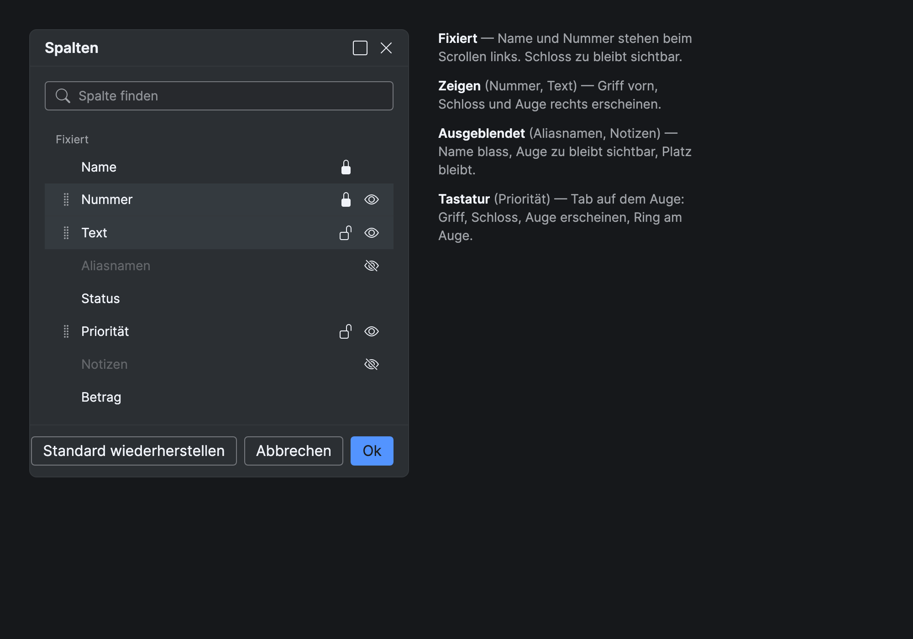

# Spaltenwahl als Ebenen-Panel — Umsetzungsplan (Stufe 1, #29825)

> **For agentic workers:** REQUIRED SUB-SKILL: Use superpowers:subagent-driven-development (recommended) or superpowers:executing-plans to implement this plan task-by-task. Steps use checkbox (`- [ ]`) syntax for tracking.

**Goal:** Die Spaltenwahl der React-Tabelle wird ein Ebenen-Panel: Zeile = Griff · Name · Schloss · Auge, Griff und
Knöpfe erscheinen beim Zeigen oder bei Fokus, ausgeblendete Spalten bleiben ausgegraut am Platz, fixierte stehen als
Block „Fixiert“ oben; das Zeilen-Gruppieren verlässt den Dialog.

**Architecture:** Das Paket erweitert `tl-reorder-list` um `__actions`, `__lock`, `__eye`, `__section` und die Zustände
`off`, `locked`, `section-end` (keine neue Komponente). Der Server (`ReactColumnSelectControl`) führt je Eintrag
`locked`, hält die fixierten Einträge als Block vorn und bekommt den Befehl `columnLock`; `TableViewControl` übernimmt
Reihenfolge und Anzahl fixierter Spalten in einem Patch. `TLColumnSelect.tsx` rendert die neue Zeile.

**Tech Stack:** Paket: CSS, `node --test`, `tools/*.mjs`. Engine: Java 17 (TopLogic `ReactControl`, `@ReactCommandHandler`,
JUnit 3 `TestCase`), React/TSX über `tl-react-bridge`, Vite, Maven.

**Spec:** `docs/superpowers/specs/2026-10-12-spaltenwahl-ebenen-design.md`

**Plan-Review:** 12.10. durch einen frischen Agenten (Fable), Probelauf des Pakets in einer Kopie, Java-Erwartungen von
Hand nachgerechnet. Befunde 1–12 sind eingearbeitet (Grundregel des Griffs, Backticks im Vertrag, Reihenfolge der
Messages-Läufe, Ring innen, Fertig-Test, Vorrichtung, Fehlererwartung, `margin-inline-start`, Tooltip-Präfix,
`section-end` über die gezeigten Einträge, Firefox-Tooltip). Freigegeben von Hendrik („plan passt so“); Ausführung in
einer frischen Sitzung.

So soll es aussehen (Bildquelle `design-system/specimen/mock/spaltenwahl-ebenen.html`):





## Global Constraints

- Ticket **#29825**; Commits beider Repos mit Präfix `Ticket #29825:`, Engine-Commits englisch, Paket-Commits deutsch,
  Trailer `Co-Authored-By: Claude Opus 5.5 <noreply@anthropic.com>`.
- Engine-Branch `CWS/CWS_29825_design_system_spaltenwahl`, **gestapelt auf** `CWS/CWS_29821_design_system_welle_3b`
  (PR !1838 ist offen); PR-Basis ist der 3b-Branch, nach dessen Merge auf master umstellen.
- Paket: `tokens.json` nur Referenzen; im CSS nur Tokens (Lint); `dist/` nur über `node tools/generate.mjs`, danach
  `node tools/publish-to-worktree.mjs` (`test/published.test.mjs` hält die Kopie byte-gleich).
- `messages_en.properties` nie von Hand: JavaDoc schreiben, `design-system/tools/check-messages-en.sh` laufen lassen,
  Diff committen, `messages_de.properties` von Hand nachziehen.
- Maven-Tests nur mit `-DskipTests=false`; nach Änderungen an vorgelagerten Modulen erst installieren.
- Kein `aria-pressed` an Auge und Schloss; den Zustand trägt der Eintrag (`data-tl-state`).
- „Beim Zeigen sichtbar“ über `opacity`, nie `visibility`/`display` — ein Knopf bleibt mit Tab erreichbar.
- Die Liste liegt auf der Fensterfläche: Ghost-Knöpfe zeigen wie in `button.css`, die Regel „Knöpfe im Feld“ gilt nicht.
- Keine Zeitangaben in Docs und Commits.

## Review Focus

1. **Tastatur ohne Maus:** Tab auf einen unsichtbaren Griff oder Knopf macht ihn sichtbar (`:focus-within`), der Ring
   liegt innen — Test in Task 2 (`:focus-within`-Regel), Sichtprüfung in Task 6.
2. **Geräte ohne Zeigen (Touch):** ohne `:hover` bliebe alles unsichtbar; `@media (hover: none)` zeigt Griff und Knöpfe
   immer — Test in Task 2.
3. **Letzte sichtbare Spalte:** Auge gesperrt mit Tooltip, der Server lehnt auch einen direkten Befehl ab, auch wenn
   die Spalte fixiert ist — Test in Task 3.
4. **Ausgeblendet und fixiert:** bleibt im Block, zählt nicht; die Tabelle bekommt die Position der letzten fixierten
   **sichtbaren** Spalte — Tests in Task 3 und Task 4.
5. **Suche aktiv:** Schloss und Auge an einem gefilterten Eintrag treffen den richtigen Eintrag (der Server arbeitet mit
   Namen), die Überschrift „Fixiert“ steht nur, wenn ein Treffer im Block liegt — Test in Task 3 (Namen), Prüfung in
   Task 5 (Rendering) und Task 6 (Sichtprüfung).

---

## Datei-Übersicht

| Datei | Verantwortung |
|---|---|
| `design-system/src/components/reorder-list/reorder-list.css` | Teile `__actions`, `__lock`, `__eye`, `__section`; Zustände `off`, `locked`, `section-end`; Beim-Zeigen-Regel; Kästchen-Regel fällt |
| `design-system/src/components/reorder-list/reorder-list.contract.md` | Vertrag: Zustand `locked`, Befehl `columnLock`, Teile, Attribute; `groupBy`, `tl-checkbox`, `aria-pressed` fallen |
| `design-system/src/components/reorder-list/reorder-list.spec.html` | Specimen mit Zeigen, Fokus, ausgeblendet, fixiert, letzter sichtbarer Spalte |
| `design-system/test/drag.test.mjs` | Regeln der neuen Teile und Zustände |
| `design-system/test/contracts-3b.test.mjs` | Pflichtbegriffe des Vertrags |
| `com.top_logic.layout.react/.../table/ReactColumnSelectControl.java` | Einträge mit `locked`, Block vorn, `columnLock`, `lockedColumns()`; `groupBy` fällt |
| `com.top_logic.layout.react/.../table/ColumnLockArguments.java` (neu) | Argumente von `columnLock` |
| `com.top_logic.layout.react/.../table/GroupByArguments.java` | gelöscht |
| `com.top_logic.layout.react/.../table/TableViewControl.java` | Dialog öffnet mit fixierten Namen, Ok/Reset setzen Reihenfolge und `frozenColumnCount` in einem Patch |
| `com.top_logic.layout.react/.../I18NConstants.java` | Schlüssel `js.table.columnShow/Hide/Lock/Unlock/columnsLocked/columnLastVisible` |
| `com.top_logic.layout.react/react-src/bridge/icons.ts` | `ICON_VISIBLE`, `ICON_HIDDEN`, `ICON_LOCK`, `ICON_UNLOCK` |
| `com.top_logic.layout.react/react-src/controls/TLColumnSelect.tsx` | rendert die neue Zeile |
| `com.top_logic.layout.react/src/test/java/test/.../table/TestReactColumnSelect.java` (neu) | Server-Logik des Dialogs |
| `com.top_logic.layout.react/src/test/java/test/.../table/TestColumnSelectionApply.java` (neu) | Übernehmen in die Tabelle |

---

### Task 1: Ticket annehmen, Branch anlegen

**Files:** keine.

**Interfaces:**
- Produces: Branch `CWS/CWS_29825_design_system_spaltenwahl` im Worktree `_Working-Tree/tl8-wt-29584`.

- [ ] **Step 1: Ticket annehmen** — Trac #29825: `get_ticket_actions`, dann `update_ticket` mit
  `{"action": "approval_direct"}`. Erwartet: Status `accepted` (der Git-Hook verlangt das).
- [ ] **Step 2: Branch anlegen**

```bash
cd _Working-Tree/tl8-wt-29584
git fetch origin
git status --porcelain | grep -v corporate   # muss leer sein
git switch -c CWS/CWS_29825_design_system_spaltenwahl origin/CWS/CWS_29821_design_system_welle_3b
```

Erwartet: Branch steht auf dem Kopf von !1838.

---

### Task 2: Paket — `tl-reorder-list` als Ebenen-Panel

**Files:**
- Modify: `design-system/src/components/reorder-list/reorder-list.css`
- Modify: `design-system/src/components/reorder-list/reorder-list.contract.md`
- Modify: `design-system/src/components/reorder-list/reorder-list.spec.html`
- Test: `design-system/test/drag.test.mjs`, `design-system/test/contracts-3b.test.mjs`

**Interfaces:**
- Produces (Klassen und Zustände, die Task 5 rendert): `tl-reorder-list__actions` (span am Zeilenende),
  `tl-reorder-list__lock`, `tl-reorder-list__eye` (je an einem `tl-button--icon --sm --ghost`),
  `tl-reorder-list__section` (li, Überschrift des Blocks), `data-tl-state` am Eintrag mit den Wörtern `off`, `locked`,
  `section-end` (neben `dragging`, `drop-before`, `drop-after`).

- [ ] **Step 1: Failing tests schreiben** — an `design-system/test/drag.test.mjs` anhängen:

```js
// Spaltenwahl als Ebenen-Panel (#29825, Spec 2026-10-12 §3): Griff und Knöpfe erscheinen beim Zeigen oder Fokus,
// über opacity — ein Knopf bleibt mit Tab erreichbar; gesetzte Zustände halten ihr Icon sichtbar.
test('tl-reorder-list: Griff, Schloss und Auge erscheinen beim Zeigen oder Fokus, nie über visibility', () => {
  const liste = readGenerated('reorder-list', 'reorder-list.css');
  const ohne = liste.replace(/\/\*[\s\S]*?\*\//g, '');
  assert.match(declarationsOf(liste, '.tl-reorder-list__handle') ?? '', /opacity:\s*0/);
  assert.match(declarationsOf(liste, '.tl-reorder-list__actions > .tl-button') ?? '', /opacity:\s*0/);
  for (const sel of [
    '.tl-reorder-list__item:hover > .tl-reorder-list__handle',
    '.tl-reorder-list__item:focus-within > .tl-reorder-list__handle',
    '.tl-reorder-list__item:hover > .tl-reorder-list__actions > .tl-button',
    '.tl-reorder-list__item:focus-within > .tl-reorder-list__actions > .tl-button',
    '.tl-reorder-list__item[data-tl-state~="off"] .tl-reorder-list__eye',
    '.tl-reorder-list__item[data-tl-state~="locked"] .tl-reorder-list__lock',
  ]) assert.match(declarationsOf(liste, sel) ?? '', /opacity:\s*1/, sel);
  assert.doesNotMatch(ohne, /visibility:\s*hidden/);
  assert.match(ohne, /@media \(hover: none\)/, 'ohne Zeigen (Touch) bleibt alles sichtbar');
});

test('tl-reorder-list: ausgeblendet blass, Block mit Linie, Überschrift, Knöpfe rechts; kein Kästchen mehr', () => {
  const liste = readGenerated('reorder-list', 'reorder-list.css');
  assert.match(declarationsOf(liste, '.tl-reorder-list__item[data-tl-state~="off"] > .tl-reorder-list__label') ?? '',
    /color:\s*var\(--tl-text-disabled\)/);
  assert.match(declarationsOf(liste, '.tl-reorder-list__item[data-tl-state~="section-end"]') ?? '',
    /border-bottom:\s*var\(--tl-border-width-sm\) solid var\(--tl-border-separator\)/);
  assert.match(declarationsOf(liste, '.tl-reorder-list__section') ?? '', /color:\s*var\(--tl-text-secondary\)/);
  assert.match(declarationsOf(liste, '.tl-reorder-list__actions') ?? '', /gap:\s*var\(--tl-space-2xs\)/);
  assert.match(declarationsOf(liste, '.tl-reorder-list__actions') ?? '', /margin-inline-start:\s*auto/);
  assert.match(declarationsOf(liste, '.tl-reorder-list__actions > .tl-button:focus-visible') ?? '',
    /outline-offset:\s*calc\(-1 \* var\(--tl-focus-offset\)\)/, 'der Ring der Knöpfe liegt innen wie am Griff');
  assert.match(declarationsOf(liste, '.tl-reorder-list__label') ?? '', /flex:\s*1 1 auto/);
  assert.equal(declarationsOf(liste, '.tl-reorder-list__item > .tl-choice'), null, 'das Kästchen fällt');
});
```

  In `design-system/test/contracts-3b.test.mjs` die Zeile für `reorder-list/reorder-list.contract.md` ersetzen:

```js
  'reorder-list/reorder-list.contract.md': ['tl-reorder-list', 'tl-reorder-list__item', 'tl-reorder-list__handle', 'tl-reorder-list__search', 'aria-describedby', 'role="status"', 'js.reorder.moved',
    'tl-reorder-list__actions', 'tl-reorder-list__lock', 'tl-reorder-list__eye', 'tl-reorder-list__section', 'data-tl-state="off"', 'locked', 'section-end', 'columnLock', 'js.table.columnLastVisible'],
```

- [ ] **Step 2: Tests laufen lassen, sie scheitern**

Run: `cd design-system && node --test test/drag.test.mjs test/contracts-3b.test.mjs 2>&1 | grep -E '^ℹ (pass|fail)|^✖'`
Expected: FAIL — die beiden neuen Tests in `drag.test.mjs` und „reorder-list.contract.md nennt … Pflichtbegriffe“.

- [ ] **Step 3: CSS ändern** — in `reorder-list.css`:
  1. Kopfkommentar, Satz „dahinter, was der Eintrag trägt (Gruppierungsknopf, label.tl-choice mit tl-checkbox)“
     ersetzen durch „dahinter die Beschriftung und rechts Schloss und Auge (tl-reorder-list__actions); Griff und Knöpfe
     erscheinen beim Zeigen oder Fokus (Spec 2026-10-12, #29825)“.
  2. Die Regel `.tl-reorder-list__item > .tl-choice { … }` samt Kommentar löschen.
  3. Die **bestehende** Regel `.tl-reorder-list__handle { color: …; cursor: grab; }` um die beiden Zeilen
     `opacity: 0;` und `transition: opacity var(--tl-duration-fast) var(--tl-easing-standard);` ergänzen — nicht in
     eine zweite Regel: `declarationsOf` im Test liest die **erste** Regel, deren Selektorliste den Selektor enthält
     (Plan-Review, Befund 1). Die bestehende Regel `.tl-reorder-list__handle:focus-visible { outline-offset: … }` auf
     die Knöpfe erweitern (sie sitzen am rechten Rand der scrollenden Liste, `base.css` legt den Ring sonst außen):

```css
.tl-reorder-list__handle:focus-visible,
.tl-reorder-list__actions > .tl-button:focus-visible {
  outline-offset: calc(-1 * var(--tl-focus-offset));
}
```

  4. Die Regel `.tl-reorder-list__label` ersetzen und dahinter einfügen:

```css
/* Die Beschriftung nimmt den Rest der Zeile und endet mit Ellipse. */
.tl-reorder-list__label {
  flex: 1 1 auto;
  min-width: 0;
  overflow: hidden;
  text-overflow: ellipsis;
  white-space: nowrap;
}

/* Rechts am Ende der Zeile: Schloss (fixieren) und Auge (aus- und einblenden). Ihre Plätze sind immer reserviert,
   damit die Zeile beim Zeigen nicht springt. */
.tl-reorder-list__actions {
  display: flex;
  flex: 0 0 auto;
  align-items: center;
  gap: var(--tl-space-2xs);
  margin-inline-start: auto;
}

/* Die Knöpfe erscheinen beim Zeigen oder wenn ein Element der Zeile den Fokus hat (der Griff ebenso, seine opacity
   steht in seiner Grundregel oben). opacity, nicht visibility: ein unsichtbarer Knopf bleibt mit Tab erreichbar und
   erscheint, sobald er den Fokus hat. */
.tl-reorder-list__actions > .tl-button {
  opacity: 0;
  transition: opacity var(--tl-duration-fast) var(--tl-easing-standard);
}

.tl-reorder-list__item:hover > .tl-reorder-list__handle,
.tl-reorder-list__item:focus-within > .tl-reorder-list__handle,
.tl-reorder-list__item:hover > .tl-reorder-list__actions > .tl-button,
.tl-reorder-list__item:focus-within > .tl-reorder-list__actions > .tl-button {
  opacity: 1;
}

/* Gesetzte Zustände bleiben zu sehen: das Auge einer ausgeblendeten, das Schloss einer fixierten Spalte. */
.tl-reorder-list__item[data-tl-state~="off"] .tl-reorder-list__eye,
.tl-reorder-list__item[data-tl-state~="locked"] .tl-reorder-list__lock {
  opacity: 1;
}

/* Ohne Zeigen (Touch) gäbe es nie :hover — dort stehen Griff und Knöpfe immer. */
@media (hover: none) {
  .tl-reorder-list__handle,
  .tl-reorder-list__actions > .tl-button {
    opacity: 1;
  }
}

/* Ausgeblendet: die Spalte behält ihren Platz, ihr Name wird blass. */
.tl-reorder-list__item[data-tl-state~="off"] > .tl-reorder-list__label {
  color: var(--tl-text-disabled);
}

/* Der Block „Fixiert“: eine Überschrift davor, eine Linie unter seinem letzten Eintrag. */
.tl-reorder-list__section {
  padding: var(--tl-space-xs) var(--tl-space-control-x) var(--tl-space-2xs);
  color: var(--tl-text-secondary);
}

.tl-reorder-list__item[data-tl-state~="section-end"] {
  border-bottom: var(--tl-border-width-sm) solid var(--tl-border-separator);
}
```

- [ ] **Step 4: Vertrag nachziehen** — in `reorder-list.contract.md`:
  - Einleitung: „Jeder Eintrag trägt vorn einen Griff, dahinter, was er braucht: Gruppierungsknopf, Kästchen mit
    Beschriftung.“ → „Jeder Eintrag trägt vorn einen Griff, dahinter die Beschriftung und rechts Schloss und Auge; Griff
    und Knöpfe erscheinen beim Zeigen oder Fokus.“
  - Zustand: Zeilen `entries[].visible` (falls vorhanden) und `entries[].grouped` ersetzen durch
    `| entries[].visible | boolean | Sichtbar; ausgeblendet trägt der Eintrag data-tl-state="off". |` und
    `` | `entries[].locked` | boolean | Fixiert (Zustand `locked`); fixierte Einträge stehen als Block vorn, der letzte trägt `section-end`. | ``
  - Aktionen: Zeilen „Kästchen umschalten“ und „Gruppierungsknopf“ ersetzen durch
    `| Auge (tl-reorder-list__eye) | sendCommand('columnVisible', …) für diesen Eintrag; an der letzten sichtbaren Spalte disabled mit Tooltip js.table.columnLastVisible. |` und
    `` | Schloss (`tl-reorder-list__lock`) | Befehl `columnLock` (`sendCommand('columnLock', …)`): zu stellt den Eintrag ans Ende des Blocks, auf direkt dahinter. | ``

  **Wichtig:** `missingInContract` verlangt den Backtick **unmittelbar** vor dem Begriff — `columnLock`, `locked`,
  `section-end` müssen je einmal als eigener Code-Span im Vertrag stehen (Plan-Review, Befund 2). Nach Step 4 prüfen:
  `grep -c '`columnLock\|`locked\|`section-end' src/components/reorder-list/reorder-list.contract.md` ≥ 3.
  - Tastatur: `Tab`-Zeile → „weiter zu Schloss und Auge des Eintrags, dann zum nächsten Griff; ein unsichtbarer Knopf
    erscheint mit dem Fokus.“
  - Tokens, Zeile `Griff`: „der Fokusring … liegt innen“ gilt auch für Schloss und Auge.
  - Tokens: Zeile `Eintrag` ergänzen um „Beschriftung blass `--tl-text-disabled` bei `off`“; neue Zeilen
    `| Knöpfe rechts | tl-reorder-list__actions, Lücke --tl-space-2xs; Griff und Knöpfe opacity 0, beim Zeigen und bei :focus-within 1, Übergang --tl-duration-fast; ohne Zeigen (hover: none) immer 1 |`,
    `| Block „Fixiert“ | Überschrift tl-reorder-list__section in tl-type-label, --tl-text-secondary; Linie unter section-end --tl-border-width-sm --tl-border-separator |`.
  - Attribute: Zeilen `aria-pressed` (Gruppierungsknopf) und `disabled` (Kästchen) ersetzen durch
    `| aria-label | an Schloss und Auge: was der Klick tut („<Name> fixieren“/„lösen“, „<Name> ausblenden“/„einblenden“); kein aria-pressed. |`,
    `| disabled | am Auge der letzten sichtbaren Spalte. |`,
    `` | `data-tl-state="off"` / `locked` / `section-end` | am Eintrag: ausgeblendet, fixiert, letzter des Blocks. | ``
  - Klassen: Zeilen `tl-button--icon` (Gruppierungsknopf) und `tl-choice` löschen, neu:
    `| tl-reorder-list__actions | span am Zeilenende um Schloss und Auge |`, `| tl-reorder-list__lock | das Schloss, mit tl-button tl-button--ghost tl-button--sm tl-button--icon |`,
    `| tl-reorder-list__eye | das Auge, ebenso |`, `| tl-reorder-list__section | li mit der Überschrift „Fixiert“, role="presentation", tl-type-label |`.
  - Symbole: „(Griff, Gruppieren, Suche, Löschen)“ → „(Griff, Schloss, Auge, Suche, Löschen)“.

- [ ] **Step 5: Specimen umbauen** — in `reorder-list.spec.html` die fünf `<li>` im Template ersetzen (Kommentar
  darüber: „Die Spaltenwahl als Ebenen-Panel: Block Fixiert mit Name (zuletzt im Block), Status wird gezogen, Region
  landet davor, Verantwortlich ausgeblendet, ‚Zuletzt geändert am‘ mit Ellipse.“):

```html
          <li class="tl-reorder-list__section tl-type-label" role="presentation">Fixiert</li>
          <li class="tl-reorder-list__item" data-tl-state="locked section-end">
            <button type="button" class="tl-button tl-button--ghost tl-button--sm tl-button--icon tl-reorder-list__handle" aria-label="Name verschieben" aria-describedby="reorder-hint"><i class="tl-icon-sm bi bi-grip-vertical tl-button__icon" aria-hidden="true"></i></button>
            <span class="tl-reorder-list__label">Name</span>
            <span class="tl-reorder-list__actions">
              <button type="button" class="tl-button tl-button--ghost tl-button--sm tl-button--icon tl-reorder-list__lock" aria-label="Name lösen"><i class="tl-icon-sm bi bi-lock-fill tl-button__icon" aria-hidden="true"></i></button>
              <button type="button" class="tl-button tl-button--ghost tl-button--sm tl-button--icon tl-reorder-list__eye" aria-label="Name ausblenden" disabled data-tooltip="text:Mindestens eine Spalte bleibt sichtbar"><i class="tl-icon-sm bi bi-eye tl-button__icon" aria-hidden="true"></i></button>
            </span>
          </li>
          <li class="tl-reorder-list__item" data-tl-state="dragging">
            <button type="button" class="tl-button tl-button--ghost tl-button--sm tl-button--icon tl-reorder-list__handle" aria-label="Status verschieben" aria-describedby="reorder-hint"><i class="tl-icon-sm bi bi-grip-vertical tl-button__icon" aria-hidden="true"></i></button>
            <span class="tl-reorder-list__label">Status</span>
            <span class="tl-reorder-list__actions">
              <button type="button" class="tl-button tl-button--ghost tl-button--sm tl-button--icon tl-reorder-list__lock" aria-label="Status fixieren"><i class="tl-icon-sm bi bi-unlock tl-button__icon" aria-hidden="true"></i></button>
              <button type="button" class="tl-button tl-button--ghost tl-button--sm tl-button--icon tl-reorder-list__eye" aria-label="Status ausblenden"><i class="tl-icon-sm bi bi-eye tl-button__icon" aria-hidden="true"></i></button>
            </span>
          </li>
          <li class="tl-reorder-list__item" data-tl-state="drop-before">
            <button type="button" class="tl-button tl-button--ghost tl-button--sm tl-button--icon tl-reorder-list__handle" aria-label="Region verschieben" aria-describedby="reorder-hint"><i class="tl-icon-sm bi bi-grip-vertical tl-button__icon" aria-hidden="true"></i></button>
            <span class="tl-reorder-list__label">Region</span>
            <span class="tl-reorder-list__actions">
              <button type="button" class="tl-button tl-button--ghost tl-button--sm tl-button--icon tl-reorder-list__lock" aria-label="Region fixieren"><i class="tl-icon-sm bi bi-unlock tl-button__icon" aria-hidden="true"></i></button>
              <button type="button" class="tl-button tl-button--ghost tl-button--sm tl-button--icon tl-reorder-list__eye" aria-label="Region ausblenden"><i class="tl-icon-sm bi bi-eye tl-button__icon" aria-hidden="true"></i></button>
            </span>
          </li>
          <li class="tl-reorder-list__item" data-tl-state="off">
            <button type="button" class="tl-button tl-button--ghost tl-button--sm tl-button--icon tl-reorder-list__handle" aria-label="Verantwortlich verschieben" aria-describedby="reorder-hint"><i class="tl-icon-sm bi bi-grip-vertical tl-button__icon" aria-hidden="true"></i></button>
            <span class="tl-reorder-list__label">Verantwortlich</span>
            <span class="tl-reorder-list__actions">
              <button type="button" class="tl-button tl-button--ghost tl-button--sm tl-button--icon tl-reorder-list__lock" aria-label="Verantwortlich fixieren"><i class="tl-icon-sm bi bi-unlock tl-button__icon" aria-hidden="true"></i></button>
              <button type="button" class="tl-button tl-button--ghost tl-button--sm tl-button--icon tl-reorder-list__eye" aria-label="Verantwortlich einblenden"><i class="tl-icon-sm bi bi-eye-slash tl-button__icon" aria-hidden="true"></i></button>
            </span>
          </li>
          <li class="tl-reorder-list__item">
            <button type="button" class="tl-button tl-button--ghost tl-button--sm tl-button--icon tl-reorder-list__handle" aria-label="Zuletzt geändert am verschieben" aria-describedby="reorder-hint"><i class="tl-icon-sm bi bi-grip-vertical tl-button__icon" aria-hidden="true"></i></button>
            <span class="tl-reorder-list__label">Zuletzt geändert am, mit einer Beschriftung, die mit Ellipse endet</span>
            <span class="tl-reorder-list__actions">
              <button type="button" class="tl-button tl-button--ghost tl-button--sm tl-button--icon tl-reorder-list__lock" aria-label="Zuletzt geändert am fixieren"><i class="tl-icon-sm bi bi-unlock tl-button__icon" aria-hidden="true"></i></button>
              <button type="button" class="tl-button tl-button--ghost tl-button--sm tl-button--icon tl-reorder-list__eye" aria-label="Zuletzt geändert am ausblenden"><i class="tl-icon-sm bi bi-eye tl-button__icon" aria-hidden="true"></i></button>
            </span>
          </li>
```

- [ ] **Step 6: Erzeugen, Lint, Tests, Veröffentlichen**

```bash
cd design-system
node tools/generate.mjs && node tools/lint-css.mjs && node tools/publish-to-worktree.mjs
node --test 2>&1 | grep -E '^ℹ (pass|fail)|^✖'
```

Expected: `Klassen-Gate grün`, alle Tests grün (vorher 354, jetzt 356). Scheitert der Specimen-Harness
(`reorder-list.spec.html besteht den Specimen-Harness`), zeigt die Meldung, welches Attribut fehlt — nachziehen.

- [ ] **Step 7: Gegenprobe** — in `reorder-list.css` die Zeile `@media (hover: none) {` vorübergehend auskommentieren,
  `node tools/generate.mjs && node --test test/drag.test.mjs` muss rot werden; zurücknehmen, erneut erzeugen und
  veröffentlichen.

- [ ] **Step 8: Commit (Paket-Repo)**

```bash
git add design-system/src/components/reorder-list design-system/dist design-system/test/drag.test.mjs design-system/test/contracts-3b.test.mjs
git commit -m "Ticket #29825: tl-reorder-list als Ebenen-Panel -- Griff, Schloss und Auge beim Zeigen oder Fokus (opacity, Touch immer), ausgeblendet blass, Block Fixiert mit Linie; Kästchen und Gruppier-Knopf fallen

Co-Authored-By: Claude Opus 5.5 <noreply@anthropic.com>"
```

---

### Task 3: Server — `ReactColumnSelectControl` mit Schloss

**Files:**
- Modify: `com.top_logic.layout.react/src/main/java/com/top_logic/layout/react/control/table/ReactColumnSelectControl.java`
- Create: `com.top_logic.layout.react/src/main/java/com/top_logic/layout/react/control/table/ColumnLockArguments.java`
- Delete: `com.top_logic.layout.react/src/main/java/com/top_logic/layout/react/control/table/GroupByArguments.java`
- Test: `com.top_logic.layout.react/src/test/java/test/com/top_logic/layout/react/control/table/TestReactColumnSelect.java`

**Interfaces:**
- Produces:
  - `public ReactColumnSelectControl(ReactContext context, List<ColumnOption> options, Set<String> lockedColumns)`
  - `public List<String> visibleColumns()` — sichtbare Namen in Reihenfolge (wie heute)
  - `public List<String> lockedColumns()` — fixierte **sichtbare** Namen in Reihenfolge
  - `public List<String> order()` — alle Namen in Reihenfolge (für Tests)
  - Befehle (public Konstanten): `CMD_COLUMN_REORDER = "columnReorder"`, `CMD_COLUMN_VISIBLE = "columnVisible"`,
    `CMD_COLUMN_LOCK = "columnLock"`
  - Zustand `entries[]`: `name`, `label`, `visible`, `locked`

- [ ] **Step 1: Failing test schreiben** — `TestReactColumnSelect.java`:

```java
/*
 * SPDX-FileCopyrightText: 2026 (c) Business Operation Systems GmbH <info@top-logic.com>
 *
 * SPDX-License-Identifier: AGPL-3.0-only OR LicenseRef-BOS-TopLogic-1.0
 */
package test.com.top_logic.layout.react.control.table;

import java.util.List;
import java.util.Map;
import java.util.Set;

import junit.framework.Test;
import junit.framework.TestCase;

import test.com.top_logic.basic.ModuleTestSetup;
import test.com.top_logic.basic.module.ServiceTestSetup;

import com.top_logic.basic.thread.ThreadContextManager;
import com.top_logic.basic.util.ResKey;
import com.top_logic.basic.util.ResourcesModule;
import com.top_logic.layout.react.DefaultReactContext;
import com.top_logic.layout.react.ReactContext;
import com.top_logic.layout.react.control.table.ColumnLockArguments;
import com.top_logic.layout.react.control.table.ColumnReorderArguments;
import com.top_logic.layout.react.control.table.ColumnVisibleArguments;
import com.top_logic.layout.react.control.table.ReactColumnSelectControl;
import com.top_logic.layout.react.servlet.SSEUpdateQueue;
import com.top_logic.layout.react.window.ReactWindowRegistry;
import com.top_logic.table.ColumnOption;

/**
 * Test of {@link ReactColumnSelectControl}: locking keeps the locked columns as a block at the start, hiding keeps a
 * column in place, and the result names the columns the table freezes.
 */
public class TestReactColumnSelect extends TestCase {

	public void testOpensWithTheLockedColumnsAsBlock() {
		ReactColumnSelectControl control = control(Set.of("c"));

		assertEquals(List.of("c", "a", "b", "d", "e"), control.order());
		assertEquals(List.of("c"), control.lockedColumns());
	}

	public void testLockMovesToTheEndOfTheBlock() {
		ReactColumnSelectControl control = control(Set.of("a"));

		assertTrue(lock(control, "d", true));

		assertEquals(List.of("a", "d", "b", "c", "e"), control.order());
		assertEquals(List.of("a", "d"), control.lockedColumns());
	}

	public void testUnlockMovesDirectlyBehindTheBlock() {
		ReactColumnSelectControl control = control(Set.of("a", "b"));

		assertTrue(lock(control, "a", false));

		assertEquals(List.of("b", "a", "c", "d", "e"), control.order());
		assertEquals(List.of("b"), control.lockedColumns());
	}

	public void testReorderIntoTheBlockLocks() {
		ReactColumnSelectControl control = control(Set.of("a", "b"));

		assertTrue(reorder(control, "d", 1));

		assertEquals(List.of("a", "d", "b", "c", "e"), control.order());
		assertEquals(List.of("a", "d", "b"), control.lockedColumns());
	}

	public void testReorderOutOfTheBlockUnlocks() {
		ReactColumnSelectControl control = control(Set.of("a", "b"));

		assertTrue(reorder(control, "a", 3));

		assertEquals(List.of("b", "c", "d", "a", "e"), control.order());
		assertEquals(List.of("b"), control.lockedColumns());
	}

	public void testReorderToTheLineKeepsTheState() {
		// The position directly at the line keeps what the moved column was: a locked one ends the block, an unlocked
		// one starts the rest.
		ReactColumnSelectControl locked = control(Set.of("a", "b"));
		assertTrue(reorder(locked, "a", 1));
		assertEquals(List.of("b", "a"), locked.lockedColumns());

		ReactColumnSelectControl unlocked = control(Set.of("a", "b"));
		assertTrue(reorder(unlocked, "e", 2));
		assertEquals(List.of("a", "b"), unlocked.lockedColumns());
		assertEquals(List.of("a", "b", "e", "c", "d"), unlocked.order());
	}

	public void testHiddenLockedColumnStaysInTheBlockButDoesNotCount() {
		ReactColumnSelectControl control = control(Set.of("a", "b"));

		assertTrue(visible(control, "b", false));

		assertEquals(List.of("a", "b", "c", "d", "e"), control.order());
		assertEquals(List.of("a"), control.lockedColumns());
		assertFalse(control.visibleColumns().contains("b"));
	}

	public void testTheLastVisibleColumnStays() {
		ReactColumnSelectControl control = new ReactColumnSelectControl(context(),
			List.of(option("a", true), option("b", false)), Set.of("a"));

		visible(control, "a", false);

		assertEquals(List.of("a"), control.visibleColumns());
		assertEquals(List.of("a"), control.lockedColumns());
	}

	public void testUnknownColumnChangesNothing() {
		ReactColumnSelectControl control = control(Set.of("a"));

		lock(control, "x", true);

		assertEquals(List.of("a", "b", "c", "d", "e"), control.order());
		assertEquals(List.of("a"), control.lockedColumns());
	}

	private static boolean lock(ReactColumnSelectControl control, String column, boolean locked) {
		return control.executeCommand(ReactColumnSelectControl.CMD_COLUMN_LOCK,
			Map.of(ColumnLockArguments.COLUMN, column, ColumnLockArguments.LOCKED, Boolean.valueOf(locked))).isSuccess();
	}

	private static boolean reorder(ReactColumnSelectControl control, String column, int target) {
		return control.executeCommand(ReactColumnSelectControl.CMD_COLUMN_REORDER,
			Map.of(ColumnReorderArguments.COLUMN, column, ColumnReorderArguments.TARGET_INDEX, Integer.valueOf(target)))
			.isSuccess();
	}

	private static boolean visible(ReactColumnSelectControl control, String column, boolean visible) {
		return control.executeCommand(ReactColumnSelectControl.CMD_COLUMN_VISIBLE,
			Map.of(ColumnVisibleArguments.COLUMN, column, ColumnVisibleArguments.VISIBLE, Boolean.valueOf(visible)))
			.isSuccess();
	}

	/** Five visible columns a to e. */
	private static ReactColumnSelectControl control(Set<String> locked) {
		return new ReactColumnSelectControl(context(),
			List.of(option("a", true), option("b", true), option("c", true), option("d", true), option("e", true)),
			locked);
	}

	private static ColumnOption option(String name, boolean visible) {
		return new ColumnOption(name, ResKey.text(name.toUpperCase()), visible);
	}

	private static ReactContext context() {
		return new DefaultReactContext("", "test", new SSEUpdateQueue(), new ReactWindowRegistry("test"));
	}

	/** Suite requiring the resources the entries resolve their labels with. */
	public static Test suite() {
		return ModuleTestSetup.setupModule(
			ServiceTestSetup.createSetup(TestReactColumnSelect.class,
				ThreadContextManager.Module.INSTANCE, ResourcesModule.Module.INSTANCE));
	}

}
```

  Hinweis: `ColumnReorderArguments` liegt im Paket `com.top_logic.layout.react.control.table` (vom Tabellenbefehl
  mitbenutzt, siehe `TestColumnCommandArguments`); prüfe mit `grep -n "TARGET_INDEX" …/ColumnReorderArguments.java`,
  dass die Konstanten so heißen.

- [ ] **Step 2: Test laufen lassen, er scheitert**

Run: `mvn -q test -DskipTests=false -pl com.top_logic.layout.react -Dtest=test.com.top_logic.layout.react.control.table.TestReactColumnSelect`
Expected: Kompilierfehler — `ColumnLockArguments`, `CMD_COLUMN_LOCK`, `lockedColumns()`, `order()` und der Konstruktor
mit `Set<String>` fehlen.

- [ ] **Step 3: `ColumnLockArguments.java` anlegen**

```java
/*
 * SPDX-FileCopyrightText: 2026 (c) Business Operation Systems GmbH <info@top-logic.com>
 *
 * SPDX-License-Identifier: AGPL-3.0-only OR LicenseRef-BOS-TopLogic-1.0
 */
package com.top_logic.layout.react.control.table;

import com.top_logic.basic.config.annotation.Label;
import com.top_logic.basic.config.annotation.Mandatory;
import com.top_logic.basic.config.annotation.Name;
import com.top_logic.layout.react.control.ReactCommand;

/**
 * Typed arguments of the command {@code columnLock} of the column selection: which column to freeze or to release.
 *
 * <p>
 * The {@link Label} also serves as template for the label provider of the configuration, which shows a recorded step
 * to people.
 * </p>
 */
@Label("Freeze column '{column}': {locked}")
public interface ColumnLockArguments extends ReactCommand {

	/** @see #getColumn() */
	String COLUMN = "column";

	/** @see #isLocked() */
	String LOCKED = "locked";

	/**
	 * The name of the column to freeze or to release.
	 */
	@Name(COLUMN)
	@Mandatory
	String getColumn();

	/**
	 * Whether the column is to stay at the start of the table while it scrolls sideways.
	 */
	@Name(LOCKED)
	@Mandatory
	boolean isLocked();

}
```

- [ ] **Step 4: `ReactColumnSelectControl` umbauen** — die Klasse durch diese Fassung ersetzen (Kopf, Lizenz und
  Klassen-JavaDoc anpassen, nicht neu erfinden):

```java
package com.top_logic.layout.react.control.table;

import java.util.ArrayList;
import java.util.LinkedHashMap;
import java.util.List;
import java.util.Map;
import java.util.Set;

import com.top_logic.basic.util.ResKey;
import com.top_logic.layout.react.ReactContext;
import com.top_logic.layout.react.control.ReactCommandHandler;
import com.top_logic.layout.react.control.ReactControl;
import com.top_logic.table.ColumnOption;
import com.top_logic.util.Resources;

/**
 * The column selection of a table as a layer panel: each column with its handle, its name, a lock that freezes it and
 * an eye that shows or hides it.
 *
 * <p>
 * The locked columns form a block at the start of the list - the columns the table freezes. Locking puts a column at
 * the end of the block, releasing it directly behind; a drop into the block locks, a drop behind it releases. A hidden
 * column keeps its place and its lock, but only displayed columns are frozen.
 * </p>
 */
public class ReactColumnSelectControl extends ReactControl {

	/** Command reordering the list (drag and drop, Alt + arrow). */
	public static final String CMD_COLUMN_REORDER = "columnReorder";

	/** Command showing or hiding one column. */
	public static final String CMD_COLUMN_VISIBLE = "columnVisible";

	/** Command freezing or releasing one column. */
	public static final String CMD_COLUMN_LOCK = "columnLock";

	/** State key of the edited column list. */
	private static final String ENTRIES = "entries";

	/** Per-entry state key of the column name. */
	private static final String ENTRY_NAME = "name";

	/** Per-entry state key of the column's display label. */
	private static final String ENTRY_LABEL = "label";

	/** Per-entry state key of whether the column is displayed. */
	private static final String ENTRY_VISIBLE = "visible";

	/** Per-entry state key of whether the column is frozen. */
	private static final String ENTRY_LOCKED = "locked";

	/** One edited column. */
	private record Entry(String name, ResKey label, boolean visible, boolean locked) {

		Entry withVisible(boolean newVisible) {
			return new Entry(name, label, newVisible, locked);
		}

		Entry withLocked(boolean newLocked) {
			return new Entry(name, label, visible, newLocked);
		}
	}

	/** The edited columns, in the edited order, the locked ones first. */
	private final List<Entry> _entries;

	/**
	 * Creates a {@link ReactColumnSelectControl}.
	 *
	 * @param context
	 *        The React context.
	 * @param options
	 *        The columns to offer, in initial display order (see
	 *        {@link com.top_logic.table.TableView#columnOptions()}).
	 * @param lockedColumns
	 *        The names of the columns the table freezes when the dialog opens.
	 */
	public ReactColumnSelectControl(ReactContext context, List<ColumnOption> options, Set<String> lockedColumns) {
		super(context, null, "TLColumnSelect");
		List<Entry> locked = new ArrayList<>();
		List<Entry> rest = new ArrayList<>();
		for (ColumnOption option : options) {
			boolean isLocked = lockedColumns.contains(option.name());
			(isLocked ? locked : rest).add(new Entry(option.name(), option.label(), option.visible(), isLocked));
		}
		_entries = new ArrayList<>(locked);
		_entries.addAll(rest);
		pushEntries();
	}

	/**
	 * The columns to display, in the edited order - the result to apply to the table.
	 */
	public List<String> visibleColumns() {
		List<String> result = new ArrayList<>(_entries.size());
		for (Entry entry : _entries) {
			if (entry.visible()) {
				result.add(entry.name());
			}
		}
		return result;
	}

	/**
	 * The displayed columns to freeze, in the edited order - the second half of the result.
	 */
	public List<String> lockedColumns() {
		List<String> result = new ArrayList<>();
		for (Entry entry : _entries) {
			if (entry.locked() && entry.visible()) {
				result.add(entry.name());
			}
		}
		return result;
	}

	/**
	 * All columns in the edited order, displayed or not.
	 */
	public List<String> order() {
		List<String> result = new ArrayList<>(_entries.size());
		for (Entry entry : _entries) {
			result.add(entry.name());
		}
		return result;
	}

	private void pushEntries() {
		Resources resources = Resources.getInstance();
		List<Map<String, Object>> entries = new ArrayList<>(_entries.size());
		for (Entry entry : _entries) {
			Map<String, Object> state = new LinkedHashMap<>();
			state.put(ENTRY_NAME, entry.name());
			state.put(ENTRY_LABEL, resources.getString(entry.label()));
			state.put(ENTRY_VISIBLE, Boolean.valueOf(entry.visible()));
			state.put(ENTRY_LOCKED, Boolean.valueOf(entry.locked()));
			entries.add(state);
		}
		putState(ENTRIES, entries);
	}

	/**
	 * Handles a drag and drop or an Alt + arrow move of one entry.
	 *
	 * <p>
	 * The position decides the lock: a column dropped into the block is locked, one dropped behind it released. The
	 * position directly at the line keeps what the column was, so a locked column ends the block and a released one
	 * starts the rest.
	 * </p>
	 */
	@ReactCommandHandler(CMD_COLUMN_REORDER)
	void handleReorder(ColumnReorderArguments args) {
		int from = indexOf(args.getColumn());
		if (from < 0) {
			return;
		}
		Entry entry = _entries.remove(from);
		int block = lockedCount();
		int target = Math.min(Math.max(args.getTargetIndex(), 0), _entries.size());
		boolean locked = entry.locked() ? target <= block : target < block;
		_entries.add(locked ? Math.min(target, block) : Math.max(target, block), entry.withLocked(locked));
		pushEntries();
	}

	/**
	 * Handles a click on the eye.
	 *
	 * <p>
	 * Hiding the last displayed column is refused: a table without columns shows nothing at all, and nothing in it
	 * could bring a column back.
	 * </p>
	 */
	@ReactCommandHandler(CMD_COLUMN_VISIBLE)
	void handleVisible(ColumnVisibleArguments args) {
		int index = indexOf(args.getColumn());
		if (index >= 0 && (args.isVisible() || visibleColumns().size() > 1)) {
			_entries.set(index, _entries.get(index).withVisible(args.isVisible()));
			pushEntries();
		}
	}

	/**
	 * Handles a click on the lock: locking puts the column at the end of the block, releasing it directly behind.
	 */
	@ReactCommandHandler(CMD_COLUMN_LOCK)
	void handleLock(ColumnLockArguments args) {
		int index = indexOf(args.getColumn());
		if (index < 0) {
			return;
		}
		Entry entry = _entries.remove(index);
		_entries.add(lockedCount(), entry.withLocked(args.isLocked()));
		pushEntries();
	}

	/** The number of locked entries, the length of the block at the start. */
	private int lockedCount() {
		int result = 0;
		while (result < _entries.size() && _entries.get(result).locked()) {
			result++;
		}
		return result;
	}

	private int indexOf(String column) {
		for (int n = 0; n < _entries.size(); n++) {
			if (_entries.get(n).name().equals(column)) {
				return n;
			}
		}
		return -1;
	}

}
```

  Danach `GroupByArguments.java` löschen. `ColumnVisibleArguments`, `ColumnReorderArguments` bleiben unverändert.

- [ ] **Step 5: Kompilieren**

Run: `mvn -q compile -pl com.top_logic.layout.react`
Expected: Fehler **nur** in `TableViewControl` (Konstruktor erwartet jetzt `Set<String>`, `groupedColumn()` fehlt).
Das ist erwartet: Task 4 zieht `TableViewControl` nach, dort laufen beide Tests, und beide Tasks werden gemeinsam
committet (Task 4 Step 6). Andere Fehler hier beheben.

---

### Task 4: `TableViewControl` übernimmt Reihenfolge und fixierte Spalten

**Files:**
- Modify: `com.top_logic.layout.react/src/main/java/com/top_logic/layout/react/control/table/TableViewControl.java`
  (Dialog um Zeile 1220–1260, `applyColumns` um Zeile 1273)
- Test: `com.top_logic.layout.react/src/test/java/test/com/top_logic/layout/react/control/table/TestColumnSelectionApply.java`

**Interfaces:**
- Consumes: Task 3 (`ReactColumnSelectControl(context, options, Set<String>)`, `visibleColumns()`, `lockedColumns()`).
- Produces: `protected void applyColumns(List<String> columns, List<String> lockedColumns)` — setzt Reihenfolge
  und `frozenColumnCount` in einem Patch.

- [ ] **Step 1: Failing test schreiben** — `TestColumnSelectionApply.java`: die Vorrichtung aus
  `TestColumnCommandArguments` vollständig übernehmen — Konstanten `COLUMN_NAME`, `COLUMN_AMOUNT`, `COLUMN_STATE`,
  `INITIAL_WIDTH`, der Record `Item`, die Hilfen `displayedColumns(TestTable)`, `initialOrder()`, `control()` (gibt
  `TestTable` zurück), `table()`, `columns()`, `suite()` (mit `TestColumnSelectionApply.class`) samt ihrer Importe
  (`DefaultColumn`, `DefaultTableView`, `ListRowSource`, `TableViewState`, `SortSpec`, `ColumnView`, `Column`,
  `TableView`, `DefaultReactContext`, `ReactContext`, `SSEUpdateQueue`, `ReactWindowRegistry`, `ThreadContextManager`,
  `ResourcesModule`, `ModuleTestSetup`, `ServiceTestSetup`) — und dazu:

```java
	private static final class TestTable extends TableViewControl<Item> {

		TestTable(ReactContext context, TableView<Item> view) {
			super(context, view, false);
		}

		/** Opens the protected {@link #applyColumns(List, List)} to the test. */
		void apply(List<String> columns, List<String> lockedColumns) {
			applyColumns(columns, lockedColumns);
		}

	}

	public void testLockedColumnsBecomeTheFrozenPrefix() {
		TestTable table = control();

		table.apply(List.of(COLUMN_STATE, COLUMN_NAME, COLUMN_AMOUNT), List.of(COLUMN_STATE, COLUMN_NAME));

		assertEquals(List.of(COLUMN_STATE, COLUMN_NAME, COLUMN_AMOUNT), displayedColumns(table));
		assertEquals(2, table.getView().frozenColumnCount());
	}

	public void testNoLockedColumnFreezesNothing() {
		TestTable table = control();
		table.getView().setFrozenColumnCount(2);

		table.apply(List.of(COLUMN_NAME, COLUMN_AMOUNT), List.of());

		assertEquals(0, table.getView().frozenColumnCount());
	}
```

  `applyColumns` wird **protected** (Step 3), damit die Unterklasse `TestTable` im Testpaket sie über `apply` aufrufen
  kann.

- [ ] **Step 2: Test laufen lassen, er scheitert**

Run: `mvn -q test -DskipTests=false -pl com.top_logic.layout.react -Dtest=test.com.top_logic.layout.react.control.table.TestColumnSelectionApply`
Expected: Kompilierfehler im **Hauptcode** `TableViewControl` (alter Konstruktoraufruf von
`ReactColumnSelectControl`, `groupedColumn()` fehlt — Folge von Task 3); der Test selbst kommt noch nicht zum Zug.

- [ ] **Step 3: Implementieren** — in `TableViewControl.java`:

  1. `applyColumns(List<String> columns)` ersetzen:

```java
	/**
	 * Applies a new set of displayed columns and the columns to freeze, and re-renders: the cell controls of the
	 * buffered rows belong to the previous columns, so they are rebuilt for the new ones.
	 *
	 * <p>
	 * Columns, frozen count and rows must reach the client as one patch: a client that already knows a newly shown
	 * column but still holds the rows of the previous column set would render a cell that has no control yet.
	 * </p>
	 *
	 * @param columns
	 *        The columns to display, in display order.
	 * @param lockedColumns
	 *        The displayed columns to freeze; the table freezes up to the last of them in the new order.
	 */
	protected void applyColumns(List<String> columns, List<String> lockedColumns) {
		Object update = beginUpdate();
		try {
			_view.setColumnOrder(columns);
			_view.setFrozenColumnCount(frozenPrefixOf(lockedColumns));
			clearCells();
			buildFullState();
		} finally {
			commitUpdate(update);
		}
	}

	/**
	 * The number of leading displayed columns up to and including the last of the given ones.
	 */
	private int frozenPrefixOf(List<String> lockedColumns) {
		int result = 0;
		List<ColumnView> displayed = _view.columns();
		for (int n = 0; n < displayed.size(); n++) {
			if (lockedColumns.contains(displayed.get(n).name())) {
				result = n + 1;
			}
		}
		return result;
	}

	/**
	 * The names of the columns the table freezes now.
	 */
	private Set<String> lockedColumnNames() {
		Set<String> result = new HashSet<>();
		List<ColumnView> displayed = _view.columns();
		for (int n = 0; n < Math.min(_view.frozenColumnCount(), displayed.size()); n++) {
			result.add(displayed.get(n).name());
		}
		return result;
	}
```

  2. Im Dialog (`new ReactColumnSelectControl(context, _view.columnOptions(), getGroupedColumn())`):

```java
		ReactColumnSelectControl selection =
			new ReactColumnSelectControl(context, _view.columnOptions(), lockedColumnNames());
```

  3. Ok-Knopf: `setGroupedColumn(selection.groupedColumn()); applyColumns(selection.visibleColumns());` ersetzen durch
     `applyColumns(selection.visibleColumns(), selection.lockedColumns());`
  4. Reset-Knopf: Kommentar „…which includes showing its rows ungrouped again“ → „…which includes showing its rows
     ungrouped and freezing no column again“; `applyColumns(_view.defaultColumnOrder());` →
     `applyColumns(_view.defaultColumnOrder(), List.of());` (`setGroupedColumn(null);` bleibt).
  5. Imports ergänzen: `java.util.HashSet`, `java.util.Set`, `com.top_logic.table.ColumnView` (falls nicht vorhanden).

- [ ] **Step 4: Tests laufen lassen**

Run: `mvn -q test -DskipTests=false -pl com.top_logic.layout.react -Dtest='test.com.top_logic.layout.react.control.table.TestColumnSelectionApply,test.com.top_logic.layout.react.control.table.TestReactColumnSelect'`
Expected: alle grün (2 + 9).

- [ ] **Step 5: Messages, Lauf 1** — vorher installieren, was das Skript offline braucht: es läuft mit `mvn -o` und
  prüft auf dem gestapelten Branch **jedes** Modul mit Java-Diff gegen `origin/master`, auch die aus 3b
  (Memory „Gate nach master-Merge: offline install“):
  `mvn -q install -DskipTests -pl com.top_logic.layout.react,com.top_logic.layout.view,com.top_logic.layout.configedit`
  (online, falls offline Abhängigkeiten fehlen). Dann `cd design-system && bash tools/check-messages-en.sh`.
  Erwartet: Diff in `messages_en.properties` (neue Schlüssel von `ColumnLockArguments`, entfernte von
  `GroupByArguments`). In `messages_de.properties` die Zeilen `…GroupByArguments…` löschen und ergänzen:

```properties
com.top_logic.layout.react.control.table.ColumnLockArguments = Spalte '{column}' fixieren: {locked}
com.top_logic.layout.react.control.table.ColumnLockArguments.column = Spalte
com.top_logic.layout.react.control.table.ColumnLockArguments.column.tooltip = Der Name der Spalte, die fixiert oder gelöst werden soll.
com.top_logic.layout.react.control.table.ColumnLockArguments.locked = Fixiert
com.top_logic.layout.react.control.table.ColumnLockArguments.locked.tooltip = Ob die Spalte beim waagerechten Scrollen am Anfang der Tabelle stehen bleibt.
com.top_logic.layout.react.control.table.ColumnLockArguments.tooltip = Typisierte Argumente des Befehls „columnLock“ der <i>Spaltenauswahl</i>: welche Spalte fixiert oder gelöst werden soll. <p> Die <i>Bezeichnung</i> dient gleichzeitig als Vorlage für die Berechnung <i>des Konfigurations-Label-Providers</i>, der einen aufgezeichneten Schritt für Menschen darstellt. </p>
```

  Die genauen Schlüssel nimmt der Ausführende aus dem erzeugten `messages_en`-Diff, nicht aus diesem Plan. **Lauf 2
  erst nach dem Commit (Step 6)**: das Skript bricht ab, solange `messages_en.properties` ungespeicherte Änderungen hat
  (Plan-Review, Befund 3).

- [ ] **Step 6: Commit (Engine)**

```bash
git add com.top_logic.layout.react/src/main/java com.top_logic.layout.react/src/test/java
git commit -m "Ticket #29825: Design System column selection -- lock freezes a column: locked columns form a block at the start, columnLock puts a column at its end or directly behind, a drop into the block locks; Ok applies order and frozen count in one patch, reset freezes none; grouping rows leaves the dialog (groupBy and GroupByArguments removed)

Co-Authored-By: Claude Opus 5.5 <noreply@anthropic.com>"
```

- [ ] **Step 7: Messages, Lauf 2** — `cd design-system && bash tools/check-messages-en.sh` → „stimmt mit dem JavaDoc
  überein“.

---

### Task 5: Client — `TLColumnSelect.tsx` rendert das Ebenen-Panel

**Files:**
- Modify: `com.top_logic.layout.react/react-src/bridge/icons.ts`
- Modify: `com.top_logic.layout.react/src/main/java/com/top_logic/layout/react/I18NConstants.java`
- Modify: `com.top_logic.layout.react/src/main/java/META-INF/messages_de.properties`
- Modify: `com.top_logic.layout.react/react-src/controls/TLColumnSelect.tsx`

**Interfaces:**
- Consumes: Task 2 (Klassen, Zustände), Task 3 (Zustand `entries[].locked`, Befehl `columnLock` mit `column`, `locked`).
- Produces: `ICON_VISIBLE`, `ICON_HIDDEN`, `ICON_LOCK`, `ICON_UNLOCK` aus `tl-react-bridge`.

- [ ] **Step 1: Icons** — in `bridge/icons.ts` nach `ICON_HANDLE` einfügen:

```ts
/** Shows a hidden entry (column selection: the eye of a hidden column). */
export const ICON_HIDDEN = 'css:fa-solid fa-eye-slash';

/** Hides a shown entry (column selection: the eye of a shown column). */
export const ICON_VISIBLE = 'css:fa-solid fa-eye';

/** Releases a frozen entry (column selection: the lock of a frozen column). */
export const ICON_LOCK = 'css:fa-solid fa-lock';

/** Freezes an entry (column selection: the lock of a column that is not frozen). */
export const ICON_UNLOCK = 'css:fa-solid fa-lock-open';
```

- [ ] **Step 2: Ressourcen** — in `I18NConstants.java` neben `JS_TABLE_COLUMN_SEARCH`:

```java
	/**
	 * @en Show {0}
	 */
	@CustomKey("js.table.columnShow")
	public static ResKey JS_TABLE_COLUMN_SHOW;

	/**
	 * @en Hide {0}
	 */
	@CustomKey("js.table.columnHide")
	public static ResKey JS_TABLE_COLUMN_HIDE;

	/**
	 * @en Freeze {0}
	 */
	@CustomKey("js.table.columnLock")
	public static ResKey JS_TABLE_COLUMN_LOCK;

	/**
	 * @en Unfreeze {0}
	 */
	@CustomKey("js.table.columnUnlock")
	public static ResKey JS_TABLE_COLUMN_UNLOCK;

	/**
	 * @en Frozen
	 */
	@CustomKey("js.table.columnsLocked")
	public static ResKey JS_TABLE_COLUMNS_LOCKED;

	/**
	 * @en At least one column stays visible
	 */
	@CustomKey("js.table.columnLastVisible")
	public static ResKey JS_TABLE_COLUMN_LAST_VISIBLE;
```

  `messages_de.properties`, neben `js.table.columnSearch`:

```properties
js.table.columnHide = {0} ausblenden
js.table.columnLastVisible = Mindestens eine Spalte bleibt sichtbar
js.table.columnLock = {0} fixieren
js.table.columnShow = {0} einblenden
js.table.columnUnlock = {0} lösen
js.table.columnsLocked = Fixiert
```

  `JS_TABLE_GROUP_BY` und `JS_TABLE_UNGROUP` bleiben: das Kontextmenü am Spaltenkopf nutzt sie.

- [ ] **Step 3: `TLColumnSelect.tsx` ersetzen**

```tsx
import { React, useTLState, useTLCommand, useI18N, useListReorder, reorderState, filterOptions, rootClassName, stateAttr, tooltipProps, ThemeIcon, ICON_HANDLE, ICON_VISIBLE, ICON_HIDDEN, ICON_LOCK, ICON_UNLOCK } from 'tl-react-bridge';
import type { TLCellProps } from 'tl-react-bridge';
import { buttonClassName } from './button/buttonClassName';
import { SearchField } from './SearchField';

const I18N_KEYS = {
  'js.table.columnSearch': 'Find column',
  'js.table.columnShow': 'Show {0}',
  'js.table.columnHide': 'Hide {0}',
  'js.table.columnLock': 'Freeze {0}',
  'js.table.columnUnlock': 'Unfreeze {0}',
  'js.table.columnsLocked': 'Frozen',
  'js.table.columnLastVisible': 'At least one column stays visible',
};

/** Shows or hides one of the columns. */
const CMD_COLUMN_VISIBLE = 'columnVisible';

/** Moves one of the columns to the position the `targetIndex` argument names. */
const CMD_COLUMN_REORDER = 'columnReorder';

/** Freezes or releases one of the columns. */
const CMD_COLUMN_LOCK = 'columnLock';

/** Argument of every command: which column it applies to. */
const ARG_COLUMN = 'column';

/** Argument of {@link CMD_COLUMN_VISIBLE}: whether the column is shown. */
const ARG_VISIBLE = 'visible';

/** Argument of {@link CMD_COLUMN_LOCK}: whether the column is frozen. */
const ARG_LOCKED = 'locked';

/** Argument of {@link CMD_COLUMN_REORDER}: the position the moved column ends up at. */
const ARG_TARGET_INDEX = 'targetIndex';

interface ColumnEntry {
  name: string;
  label: string;
  visible: boolean;
  /** Whether the table freezes this column; the locked entries stand as a block at the start. */
  locked: boolean;
}

/** Fills the placeholder {0} of a translated text. */
function format(template: string, arg: string): string {
  return template.replace('{0}', arg);
}

/**
 * The column selection of a table as a layer panel (design system: tl-reorder-list): each column with its handle at
 * the start, its name, and at the end a lock that freezes it and an eye that shows or hides it. Handle, lock and eye
 * appear on hover or focus; a hidden column keeps its place, dimmed, and shows its closed eye, a frozen one its lock.
 * The frozen columns stand as a block under the heading "Frozen".
 *
 * Order, visibility and lock live on the server (see ReactColumnSelectControl), so a gesture sends a command and the
 * re-pushed list is what renders.
 */
const TLColumnSelect: React.FC<TLCellProps> = ({ controlId }) => {
  const state = useTLState();
  const sendCommand = useTLCommand();
  const i18n = useI18N(I18N_KEYS);

  const entries = (state.entries as ColumnEntry[] | undefined) ?? [];
  const visibleCount = entries.filter((entry) => entry.visible).length;

  // A table over a large type offers a column per attribute, which is a long list to scroll. The search narrows what
  // is rendered; the full list stays the reference for the drop position, so a row can be dropped next to a row the
  // search has hidden. Each rendered row therefore carries its position within the full list.
  const [search, setSearch] = React.useState('');
  const matches = new Set(filterOptions(entries, search));
  const shown = entries.map((entry, index) => ({ entry, index })).filter(({ entry }) => matches.has(entry));
  const lastLockedShown = shown.filter(({ entry }) => entry.locked).pop()?.index;
  // The line under the block only where something follows it: a search can leave the block alone.
  const hasUnlockedShown = shown.some(({ entry }) => !entry.locked);

  const handleToggle = React.useCallback((name: string, visible: boolean) => {
    sendCommand(CMD_COLUMN_VISIBLE, { [ARG_COLUMN]: name, [ARG_VISIBLE]: visible });
  }, [sendCommand]);

  const handleLock = React.useCallback((name: string, locked: boolean) => {
    sendCommand(CMD_COLUMN_LOCK, { [ARG_COLUMN]: name, [ARG_LOCKED]: locked });
  }, [sendCommand]);

  // The moved column is named rather than counted: the server resolves it against its own working copy, which the
  // client's list is only a picture of. The server also decides the lock from where the column lands.
  const handleMove = React.useCallback((from: number, targetIndex: number) => {
    const moved = entries[from];
    if (moved) {
      sendCommand(CMD_COLUMN_REORDER, { [ARG_COLUMN]: moved.name, [ARG_TARGET_INDEX]: targetIndex });
    }
  }, [entries, sendCommand]);

  const reorder = useListReorder({
    axis: 'vertical',
    onMove: handleMove,
    count: entries.length,
    labelOf: (i) => entries[i]?.label ?? '',
    keyOf: (i) => entries[i]?.name ?? String(i),
  });

  const searchable = entries.length > 10;

  return (
    <div id={controlId} className={rootClassName(state)} {...reorder.containerProps}>
      {searchable && (
        <SearchField
          className="tl-reorder-list__search"
          label={i18n['js.table.columnSearch']}
          placeholder={i18n['js.table.columnSearch']}
          value={search}
          onChange={setSearch}
        />
      )}
      <ul className="tl-reorder-list tl-type-body">
        {lastLockedShown !== undefined && (
          <li className="tl-reorder-list__section tl-type-label" role="presentation">{i18n['js.table.columnsLocked']}</li>
        )}
        {shown.map(({ entry, index }) => {
          // Keep the table from losing its last column: there would be nothing left to click.
          const lastVisible = entry.visible && visibleCount <= 1;
          const eyeLabel = lastVisible
            ? i18n['js.table.columnLastVisible']
            : format(i18n[entry.visible ? 'js.table.columnHide' : 'js.table.columnShow'], entry.label);
          const lockLabel = format(i18n[entry.locked ? 'js.table.columnUnlock' : 'js.table.columnLock'], entry.label);
          const handle = reorder.handleProps(index);
          return (
            <li
              key={entry.name}
              className="tl-reorder-list__item"
              data-tl-state={stateAttr(
                reorderState(reorder.itemState(index)),
                !entry.visible && 'off',
                entry.locked && 'locked',
                index === lastLockedShown && hasUnlockedShown && 'section-end',
              )}
              {...reorder.itemProps(index)}
            >
              <button
                type="button"
                className={buttonClassName({ appearance: 'ghost', small: true, icon: true, extra: 'tl-reorder-list__handle' })}
                {...tooltipProps(handle['aria-label'])}
                {...handle}
              >
                <ThemeIcon encoded={ICON_HANDLE} className="tl-button__icon tl-icon-sm" />
              </button>
              <span className="tl-reorder-list__label">{entry.label}</span>
              <span className="tl-reorder-list__actions">
                <button
                  type="button"
                  className={buttonClassName({ appearance: 'ghost', small: true, icon: true, extra: 'tl-reorder-list__lock' })}
                  aria-label={lockLabel}
                  {...tooltipProps(lockLabel)}
                  onClick={() => handleLock(entry.name, !entry.locked)}
                >
                  <ThemeIcon encoded={entry.locked ? ICON_LOCK : ICON_UNLOCK} className="tl-button__icon tl-icon-sm" />
                </button>
                <button
                  type="button"
                  className={buttonClassName({ appearance: 'ghost', small: true, icon: true, extra: 'tl-reorder-list__eye' })}
                  aria-label={eyeLabel}
                  {...tooltipProps(eyeLabel)}
                  disabled={lastVisible}
                  onClick={() => handleToggle(entry.name, !entry.visible)}
                >
                  <ThemeIcon encoded={entry.visible ? ICON_VISIBLE : ICON_HIDDEN} className="tl-button__icon tl-icon-sm" />
                </button>
              </span>
            </li>
          );
        })}
      </ul>
      {reorder.announcer}
    </div>
  );
};

export default TLColumnSelect;
```

  Prüfe vorher mit `grep -n "export function stateAttr" react-src/bridge/css.ts` und
  `grep -n "stateAttr" react-src/bridge-entry.ts`, dass `stateAttr` aus `tl-react-bridge` exportiert ist; sonst in
  `bridge-entry.ts` ergänzen.

- [ ] **Step 4: Typprüfung und Bundles**

Run: `cd com.top_logic.layout.react && npm run build`
Expected: `tsc` ohne Fehler, zwei Vite-Builds „built in …“.

- [ ] **Step 5: Fertig-Bedingung als Test, Engine-Gate, Messages** — an `design-system/test/engine-classes.test.mjs`
  anhängen (Paket-Repo, eigener Commit `Ticket #29825: Gate -- die Spaltenwahl trägt kein Kästchen, kein
  Gruppieren, kein aria-pressed`):

```js
test('die Spaltenwahl ist ein Ebenen-Panel: kein Kästchen, kein Zeilen-Gruppieren, kein aria-pressed (#29825)', { skip: !existsSync(M) && 'kein Worktree' }, () => {
  const tsx = readFileSync(join(M, 'react-src/controls/TLColumnSelect.tsx'), 'utf8');
  assert.doesNotMatch(tsx, /aria-pressed|tl-checkbox|tl-choice|grouped|groupBy/);
});
```

```bash
cd design-system && node --test test/engine-classes.test.mjs 2>&1 | grep -E '^ℹ (pass|fail)'
bash tools/check-messages-en.sh
```

Expected: grün; `messages_en` erzeugt die sechs `js.table.*`-Schlüssel (Diff committen), zweiter Lauf ohne Diff.

- [ ] **Step 6: Commit (Engine)**

```bash
git add com.top_logic.layout.react/react-src com.top_logic.layout.react/src/main/java
git commit -m "Ticket #29825: Design System column selection -- TLColumnSelect renders the layer panel: handle at the start, name, lock and eye at the end, shown on hover or focus; hidden columns stay in place dimmed, frozen ones form the block 'Frozen'; eye and lock name what a click does

Co-Authored-By: Claude Opus 5.5 <noreply@anthropic.com>"
```

---

### Task 6: Gates, Sichtprüfung, Doku, Push

**Files:**
- Modify: `STATUS.md`, `docs/migration/altlast.md`, `docs/skalen.md` (Abschnitt „Die Spaltenwahl neu“: „gebaut“),
  `docs/praesentation.md` (Sprechnotiz nur, falls sich die Botschaft ändert)

- [ ] **Step 1: Alle Gates**

```bash
cd design-system && node --test 2>&1 | grep -E '^ℹ (pass|fail)' && node tools/lint-css.mjs | tail -1
cd ../_Working-Tree/tl8-wt-29584
mvn -q clean test -DskipTests=false -pl com.top_logic.layout.react
bash ../../design-system/tools/check-messages-en.sh
```

Expected: Paket grün; `layout.react` 0 Failures (bisher 601 Tests, jetzt 612); Messages ohne Diff.

- [ ] **Step 2: Sichtprüfung lokal** (Rezept Memory „Lokale Demo statt Docker“; H2-Autoconf neu anlegen, falls der
  Scratchpad fehlt). Attribute → Tabelle → Zahnrad, hell und dunkel, normal und kompakt:
  1. Ohne Zeigen: nur Namen, Auge zu an ausgeblendeten, Schloss an fixierten Spalten.
  2. Zeigen einer Zeile: Griff vorn, Schloss und Auge rechts; die Zeile springt nicht.
  3. Tab von der Suche: Griff erscheint mit Ring, weiter Tab: Schloss, Auge — jeweils sichtbar mit Ring.
  4. Schloss an „Text“: Text wandert ans Ende des Blocks „Fixiert“, Linie darunter; Ok → in der Tabelle bleibt Text beim
     waagerechten Scrollen links.
  5. Auge an „Text“: Name blass, Auge zu; Ok → Spalte fehlt in der Tabelle; Dialog erneut → Text am selben Platz.
  6. Alle Spalten bis auf eine ausblenden: das Auge der letzten ist gesperrt, Tooltip „Mindestens eine Spalte bleibt
     sichtbar“ — in Chrome **und Firefox** (Firefox meldet kein `pointerover` an deaktivierten Knöpfen; fehlt der
     Tooltip dort, `aria-disabled` statt `disabled` und den Klick im Handler abfangen).
  7. Suche „Dat“: Überschrift „Fixiert“ nur, wenn ein Treffer fixiert ist; Schloss an einem Treffer trifft ihn.
  8. „Standard wiederherstellen“: Spalten wie definiert, nichts fixiert, nicht gruppiert.
  9. Spaltenkopf → Kontextmenü „Nach dieser Spalte gruppieren“ funktioniert weiter.
  Befunde als Fix-Commits mit Test.

- [ ] **Step 3: Doku** — `skalen.md` „Die Spaltenwahl neu“: Satz „**Gebaut** (Stufe 1, #29825, Engine `<Kopf>`).“
  anhängen; `altlast.md` „Offen nach 3b“ Zeile Spaltenwahl auf „gebaut“ setzen, `TLColumnSelect` liest kein
  `tl-checkbox` mehr; `STATUS.md` Eintrag mit Commits, Gates, Sichtprüfung. Commit Paket-Repo
  (`Ticket #29825: …`), push `main` (vorher `git fetch`).

- [ ] **Step 4: Push und PR** (nur mit Hendriks „push“)

```bash
cd _Working-Tree/tl8-wt-29584 && git fetch origin
git push -u origin CWS/CWS_29825_design_system_spaltenwahl
```

  PR gegen `CWS/CWS_29821_design_system_welle_3b` (gestapelt), Titel
  „Ticket #29825: Design System -- column selection as a layer panel“, Beschreibung englisch mit den Bildern als
  Raw-URL aus `TopLogic/tl-design-system` `docs/bilder/`, Reviewer `bhu`, Trac-Kommentar in #29825. Nach dem Merge
  von !1838 die Basis auf `master` umstellen.
